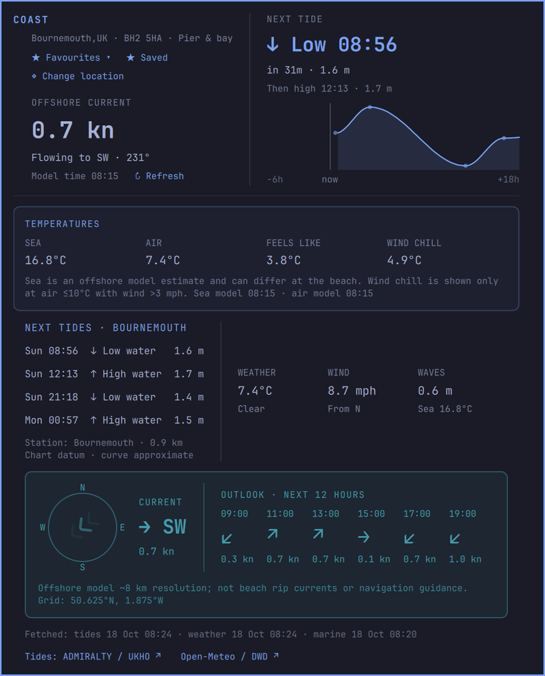
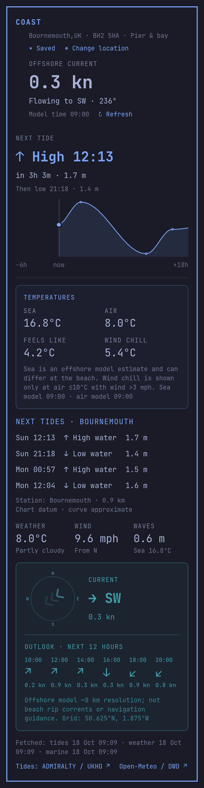

# Coast

Native Omarchy bar plugin for tides, offshore currents, sea temperature and
coastal weather. Bournemouth (BH2 5HA, the pier and the offshore bay) is the
default; other coasts can be chosen from the panel. Click the wave icon on the
left of the bar to open it. Middle-click or press Enter in the popup to refresh.
Escape dismisses it. Colours, font, spacing and borders follow the active
Omarchy theme automatically.



> **Limitations.** Currents and sea temperature are a coarse offshore model
> (~8 km), not beach conditions or navigation guidance. Coast shows readings
> only and gives no swimming or safety advice. Tide times cover UK coasts only
> (ADMIRALTY) and need a free API key; elsewhere the panel shows no tides.
> See [Data and accuracy](#data-and-accuracy).

## Install

Requires Omarchy with its shell (Quickshell) and Python 3.

```bash
omarchy plugin add https://github.com/paulwitcombe/coast --enable
```

This clones the plugin into `~/.config/omarchy/plugins/pdog.coast`, validates it
and puts the wave icon in the bar (left section by default). Then:

- Open: click the icon, or `omarchy-shell pdog.coast open`
- Update: `omarchy plugin update pdog.coast`
- Disable: `omarchy plugin disable pdog.coast`
- Remove: `omarchy plugin remove pdog.coast`

### Tide times (UK): free ADMIRALTY key

Weather, currents and temperatures work straight away. Tide times come from the
UK Hydrographic Office's ADMIRALTY UK Tidal API, which needs a free key:

1. Create an account at https://developer.admiralty.co.uk/, open **Products →
   UK Tidal API – Discovery** and subscribe (free for a year, renewable).
2. On your **Profile** page, click **Show** next to the subscription's
   **Primary key** and copy it.
3. In a terminal, run:

   ```bash
   ~/.config/omarchy/plugins/pdog.coast/set-admiralty-key.sh
   ```

   Paste the key when asked (it isn't shown). It is saved to
   `~/.config/omarchy/coast/admiralty-key` with owner-only permissions, outside
   the plugin folder. Alternatively set `ADMIRALTY_API_KEY` in the environment.

The Discovery terms don't allow tide data to be cached or stored, so Coast
never writes it to disk. Tides are fetched live when the panel opens (two
requests: the station list and that station's events), then at most hourly
while it stays open (predictions don't change), or when you refresh. In
between, the open panel keeps them in memory so the countdown can tick, and
drops them when it closes. With the panel closed, only weather and currents
update, so the bar tooltip shows no tide.

Discovery allows 10,000 requests a month. If ADMIRALTY can't be reached or the
quota is used up, the panel says "Tide data temporarily unavailable" and tries
again an hour later (or on Refresh). The portal's analytics show your usage,
and ADMIRALTY emails a warning at 75% of the quota.

## Panel layout

Everything fits on screen at once, top to bottom:

1. **Location and tide summary.** Two halves with a faint divider midway
   between them.
   - Left, under the **COAST** heading: the location as `Town,CC · detail`
     (for example `Bournemouth,UK · BH2 5HA · Pier & bay`), Favourites / Save,
     Change location, then the **offshore current**: speed, the direction it is
     flowing to, the model time and Refresh. Below 0.3 kn it adds
     "Near slack water · direction unsettled".
   - Right, **NEXT TIDE**: the next high or low, a countdown and height, the tide
     after it, and a chart of the water level from 6 hours ago to 18 hours ahead
     with a marker for now.
2. **Temperatures.** Sea, air, feels-like and wind chill as plain readings
   (see below).
3. **Next tides and weather.** The next four highs and lows as a compact table,
   then a divider, then **weather**, **wind** and **waves**.
4. **Current.** A box in the theme's sea colour combining the compass (the
   direction and speed) with the **outlook for the next 12 hours** in two-hour
   steps, plus the offshore model note and grid coordinates.
5. **Footer.** Warnings when a feed is stale or unavailable, when each feed was
   last fetched, and source links.

The sea colour is the theme's `cyan`, read from the active theme's
`colors.toml`, so it changes with the theme (falling back to `#449dab`).

## Data and accuracy

Tide times and heights above chart datum come from the ADMIRALTY UK Tidal API
(UK Hydrographic Office), for the nearest of its 607 UK stations within 30 km of
the chosen location. The station and its distance are shown under the tide
list. The API returns times in UTC; the panel shows them in the location's
timezone. The tide chart is eased between the predicted highs and lows (a cosine
approximation), so it shows the shape of the tide, not measured levels.

Weather and offshore currents come from Open-Meteo. Current speed is converted
to knots using the units the API returns. The compass points **towards** the
flow: Open-Meteo reports direction as where the current is heading (0° = north,
90° = east). Below 0.3 kn the chevrons dim, because the modelled direction swings
while the stream turns. The marine model runs at about 8 km resolution and its
coastal accuracy is limited: this is a coarse offshore forecast, not a
measurement of beach rip currents or a navigation aid. Wind direction is
separately labelled **from**.

No new packages required. Uses Python 3 and the existing Omarchy shell.
Weather/marine feeds are cached for 15 minutes under `~/.cache/omarchy-coast`.
Tide data is never cached (see [the key section](#tide-times-uk-free-admiralty-key)).
Failed weather/marine requests retain cached data with a warning; current
conditions older than 2 hours are hidden. Times use the location's timezone
with automatic daylight-saving changes. Without a key, or away from UK stations, the panel says why there are
no tide times rather than estimating them.

Sources:
- https://developer.admiralty.co.uk/ (ADMIRALTY UK Tidal API)
- https://open-meteo.com/en/docs
- https://open-meteo.com/en/docs/marine-weather-api (Open-Meteo / DWD attribution)

## Temperatures

The temperature box shows four readings and nothing else: sea surface
temperature (offshore marine model), air temperature, apparent (feels-like)
temperature and the NWS wind-chill index. Wind chill is only defined at air
≤10°C with wind >3 mph, so it shows "—" otherwise. Coast gives no swimming,
health or safety advice and makes no judgement about the readings.

Readings are withheld (shown as "—") when they are missing, out of range, older
than 2 hours, or come back from the API in unexpected units. The offshore sea
estimate can differ from the temperature at the beach. The box notes when each
model reading is from.

- https://www.weather.gov/safety/cold-wind-chill-chart (wind-chill formula)

## Locations

Click **Change location** under the heading (or press `/` while the panel is open).
Search for a town, optionally followed by a country (postcodes aren't supported
by the search service), then click a
result. Keyboard: Enter searches; Down/Up selects a result; Enter applies it;
Escape closes the picker. Results show `Town,CC · region`, then the timezone and
coordinates to distinguish namesakes. Choose coastal places; the search also
includes inland places and does not certify beach suitability.

Country abbreviations come from the search result's ISO code, written `UK`
rather than `GB`. Locations saved without one get it from their timezone via the
system tzdata table.

The last eight locations are saved, keeping Bournemouth available. The picker
also offers °C/°F; the chosen unit is carried across subsequent location changes.
Active location and recents are saved atomically at
`~/.config/omarchy/coast/locations.json` (respects `XDG_CONFIG_HOME`), outside the
plugin directory so selections do not trigger shell reloads. Old readings are
cleared when changing location; selection is disabled during an active fetch.
Search uses Open-Meteo / GeoNames and sends the typed query to that service.

Bournemouth is the initial default. For advanced configuration, edit the active
location in the saved state file. Before any picker selection, a legacy
`location.json` beside `coast.py` is also accepted, for example:

```json
{
  "name": "Sydney",
  "detail": "Bondi Beach",
  "country": "AU",
  "latitude": -33.8915,
  "longitude": 151.2767,
  "marineLatitude": -33.90,
  "marineLongitude": 151.30,
  "timezone": "Australia/Sydney",
  "temperatureUnit": "C"
}
```

Use an IANA timezone and `C` or `F` for display.
`country` is optional. Marine coordinates default to the supplied land
coordinates if omitted; select an appropriate offshore point for better coverage.
Cache filenames include the source URL hash, keeping locations separate. Invalid
config fails visibly, never silently falls back to another beach.

Weather and marine model coverage is global but availability and coastal accuracy
vary. Tides are picked automatically from the nearest ADMIRALTY station, so they
work for any UK location searched; other countries have no tide provider yet.
Worldwide tide-provider adapters, localisation and broader unit preferences
remain future work. Returned marine
grid cells more than 30 km from the selected location are withheld; this is a
coverage guard, not a guarantee of beach-level accuracy.

## Favourites

Use **☆ Save** beside the location controls to favourite the current coast;
**★ Saved** removes it. **★ Favourites** opens a dropdown with a rolling wave
edge and staggered entries; select an entry to switch location. Press `f` to
toggle the dropdown and Escape to close it. Longer lists scroll within the menu.
Favourites persist separately from the eight recent locations and are not evicted
by new searches. Existing saved state starts with the active location favourited;
an explicitly empty favourites list stays empty. State writes remain atomic.

## iPhone (Scriptable)

Coast also runs on iOS in [Scriptable](https://scriptable.app), a free app that
runs JavaScript. It gives you home screen and lock screen widgets, and the full panel
in the same Omarchy style when you open it. It talks to the APIs directly, so it
works anywhere without the laptop.



**Install**

1. Install Scriptable from the App Store.
2. On the iPhone, open
   https://raw.githubusercontent.com/paulwitcombe/coast/main/ios/install.js in
   Safari, select all and copy.
3. In Scriptable, tap **+**, paste, name the new script **Install Coast** (not
   Coast) and run it from its tile. It downloads `ios/Coast.js` and saves it as
   the **Coast** script. You can delete the installer afterwards.
4. Open **Coast** and paste your ADMIRALTY primary key when asked. It is stored
   in the iOS Keychain, not in the script.
5. Add a Scriptable widget to the home screen or lock screen, long-press it,
   choose **Edit Widget** and pick **Coast**. Set **Parameter** to the name of a
   favourite (for example `Poole`) to pin that widget to it.

**Updating.** In the Coast panel, tap **Change location**, then **Update
Coast**. It downloads the latest version over itself; close and reopen Coast to
use it. The panel's footer shows the version you're running. Always run Coast
from its tile: running it from inside the editor uses the editor's copy.

**What it shows**

- **Widgets.** Small: the next tide, countdown, current and sea temperature.
  Medium adds the compass and tide chart. Large adds the next four tides and
  temperatures. Lock screen: labelled Tide (↑ high, ↓ low), Current and Sea
  lines.
- **Panel.** Tap a widget or run the script: the same sections as the Omarchy
  panel, with location search, favourites, °C/°F and Refresh.

**Tide data and your quota.** The phone uses the same rules as the laptop:
tide data is fetched live on every run and never stored. Widgets ask iOS to
refresh at most hourly, so the phone uses about 1,500 of your 10,000 requests a
month even with a widget on screen all day. The phone and laptop share the
quota because they use the same key. Locations, favourites and units are saved
in Scriptable's own folder on the phone, with the last weather and currents
reading from Open-Meteo, which stands in (marked cached) if the service is down.

The panel appears at once and shows whatever has arrived after 4 seconds, so
one slow service doesn't hold it up; the rest fills in when it comes.

**Theme.** The script carries the Omarchy theme colours in a `THEME` line near
the top (Tokyo Night by default). To match a different Omarchy theme, run
`python3 -B ~/.config/omarchy/plugins/pdog.coast/ios/theme.py` and paste its
output over that line in Scriptable. The panel uses JetBrains Mono; widgets use
the system monospaced font, as iOS widgets can't load web fonts.

## Files

- `Widget.qml`: bar button and panel.
- `CurrentCompass.qml`: the current compass dial; no shell imports, so it can be
  rendered on its own to check orientation.
- `coast.py`: fetches the feeds (caching Open-Meteo only) and combines them into one report.
- `location.py`: location search, recents, favourites and saved state.
- `temperatures.py`: validates the temperature readings and works out wind chill.
- `tides.py`: ADMIRALTY station lookup and tide events.
- `set-admiralty-key.sh`: saves your ADMIRALTY key without showing it.
- `ios/Coast.js`: the iPhone version for Scriptable (widgets and panel).
- `ios/install.js`: installs or updates it in Scriptable.
- `ios/theme.py`: prints the `THEME` line for your current Omarchy theme.
- `ios/test_coast.js`, `ios/preview.js`: its tests, and a preview of the panel
  with live data (`node ios/preview.js > coast.html`).

## Development

Clone into the plugins folder to work on it directly; saved changes reload the
plugin:

```bash
git clone https://github.com/paulwitcombe/coast ~/.config/omarchy/plugins/pdog.coast
omarchy plugin enable pdog.coast
```

Run checks: `python3 -B -m unittest discover -s . -v` (`-B` stops `__pycache__`
being written into the plugin folder, which would reload the shell) and
`node --test ios/test_coast.js` for the iPhone script.

Saving files under `~/.config/omarchy/plugins/` hot-reloads the plugin, but the
shell can keep a cached copy of the old widget. If a change doesn't appear, run
`omarchy restart shell`.

## Licence

MIT. See [LICENSE](LICENSE). Data stays under its providers' terms: Open-Meteo
(CC BY 4.0), GeoNames (CC BY 4.0) via Open-Meteo geocoding, and ADMIRALTY tide
predictions (© Crown copyright, UK Hydrographic Office) under your own API
subscription's terms. Each user needs their own key.
